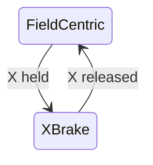

# 78's Kotlin Template

Use this template to start a state-machine robot project in Kotlin. The template has a CTRE swerve
drivetrain, an operator interface (OI), and a git commit on each deploy at events.

## Requirements

This project uses WPILib 2027 alpha 8 for SystemCore.

1. Install WPILib 2027 alpha 8. The installer also installs JDK 25.
2. Use FIRST Driver Station alpha 7 or later.
3. Make sure that SystemCore has image 14 or later.

To start the simulation, run `./gradlew run`. The `simulateJava` task is not in WPILib 2027.

## Project layout

| File                                | Contents                                                     |
|-------------------------------------|--------------------------------------------------------------|
| `Robot.kt`                          | Logging setup and the calls to each subsystem state machine. |
| `OI.kt`                             | All controller inputs.                                       |
| `auto/Auto.kt`                      | Interface for each auto routine.                             |
| `subsystems/SwerveDrivetrain.kt`    | Drivetrain state machine, drive to pose, rotate around point.|
| `generated/TunerConstants.java`     | Swerve constants from CTRE Tuner X.                          |
| `generated/Telemetry.kt`            | Swerve state output to NetworkTables.                        |
| `lib/Units.kt`                      | Unit extension properties.                                   |
| `lib/Math.kt`                       | Joystick curve and scale, vector destructuring, #25 sprocket.|

## State machines

Each subsystem is a Kotlin `object` with a `currentState` and two functions:

- `stateTransitions()` reads the OI and changes `currentState`.
- `stateActions()` sends outputs to the motors for `currentState`.

`Robot.teleopPeriodic()` calls the two functions one time each loop. Do not read controllers in a
subsystem. Add a function to `OI` and call that function.



To add a state, add a value to `SwerveState`. Then add a branch to `stateTransitions()` and to
`stateActions()`. The `when` statements do not compile until each state has a branch.

To drive to a target in a state, call `driveToPose()` or `rotateAroundPoint()` from the branch of
that state in `stateActions()`.

## Driving

| Driver controller (port 0) | Action                                  |
|----------------------------|-----------------------------------------|
| Left stick                 | Field-centric translation               |
| Right stick X              | Rotation                                |
| X (hold)                   | X-brake                                 |
| Menu + View (hold)         | Set the current heading as "forward"    |

The left stick gives a vector. The code squares the length of the vector, so the drive direction
does not change. The code then scales the translation and the rotation together, so that the fastest
module turns at the speed that the sticks ask for. No module saturates.

When you release the rotation stick for 350 ms, the robot holds its heading.

The drivetrain state machine runs only in teleop. In auto, call these functions one time each loop:

- `driveToPose(target, threshold)` drives to a field pose. It returns `true` when the robot is
  in the threshold.
- `rotateAroundPoint(targetHeading, centerOfRotation, threshold)` turns the robot around a point.
  The point is relative to the robot center. It returns `true` when the heading is in the
  threshold.

Use blue-origin field coordinates for each pose.

## Autos

Each auto is an `object` that implements `Auto`:

- `init()` runs one time when auto starts. Set the first step here.
- `run()` runs each loop in auto. Use a `when` on the current step. Go to the next step when
  `driveToPose()` or `rotateAroundPoint()` returns `true`.

```kotlin
object SampleAuto : Auto {
    enum class Step { Drive, Turn, Done }

    private var step = Step.Drive

    override fun init() {
        step = Step.Drive
    }

    override fun run() {
        when (step) {
            Step.Drive ->
                if (SwerveDrivetrain.driveToPose(Pose2d(2.0, 4.0, Rotation2d.ZERO), 2.inches))
                    step = Step.Turn
            Step.Turn ->
                if (
                    SwerveDrivetrain.rotateAroundPoint(
                        Rotation2d.k180deg,
                        Translation2d(0.5, 0.0),
                        2.degrees,
                    )
                )
                    step = Step.Done
            Step.Done -> SwerveDrivetrain.brake()
        }
    }
}
```

To add an auto, add it to `autoChooser` in `Robot.kt`. The first argument is the name that the
dashboard shows:

```kotlin
private val autoChooser =
    LoggedNetworkChooser<Auto>("Auto").apply {
        addDefault("Sample", SampleAuto)
        add("Other", OtherAuto)
    }
```

The chooser is in NetworkTables at `/Auto`. Select the auto on the dashboard before the match
starts. AdvantageKit logs the selection, so a replay runs the same auto. If no auto is selected,
the robot does not move in auto.

## Swerve setup

1. Use the CTRE Tuner X Swerve Project Generator to make a new `TunerConstants.java` for your
   robot.
2. Replace `src/main/java/frc/robot/generated/TunerConstants.java` with the new file.
3. Do not change the other files in `generated/`.

The template file has the constants for the 2026 robot. Do not drive a different robot with these
constants.

## Git commit on deploy

Before an event, make a branch that starts with `event`, for example `event-district1`. When you
deploy from this branch, Gradle adds all changes and makes a commit. Thus, each deploy at an event
has a commit.

On other branches, Gradle does not make a commit.

The build also writes `BuildConstants.kt` with the git branch, SHA, and build date. `Robot.kt`
records these values as AdvantageKit metadata. Use them to find the code that was on the robot
for a match log.

## Units

The WPILib Java Units Library is very verbose. Kotlin extension properties make units easier to
use. [Units.kt](src/main/java/frc/robot/lib/Units.kt) has extension properties for frequently used
units.

```kotlin
val distance = 5.feet

val inches = distance.inches
```

## Spotless

Spotless formats Kotlin with `ktfmt` and Java with `google-java-format`. Run `./gradlew
spotlessApply` before you commit. The GitHub action does a check of the format on each push.
